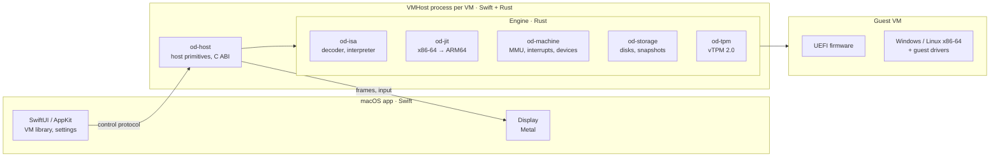

<div align="center">

# Open Desktop

**Run x86-64 Windows and Linux on Apple Silicon Macs, powered by an emulation engine built from scratch.**

[](LICENSE)
[](#requirements)
[](https://www.rust-lang.org)
[](#status)

[Architecture](#architecture) · [Status](#status) · [Building](#building) · [Documentation](#documentation) · [Contributing](#contributing) · [License](#licensing)

</div>

> [!WARNING]
> Open Desktop is in early development. It cannot boot a guest operating system yet and is not intended for end users. Watch the repository to follow progress.

## About

Open Desktop is a desktop virtualization product for macOS that runs full x86-64 guest operating systems on Apple Silicon. Unlike products that rely on existing emulators, every core piece is written in this project:

- **Own x86-64 decoder and reference interpreter**, checked instruction by instruction against real x86 hardware.
- **Own JIT** that translates x86-64 to native ARM64 through its own IR and code emitter, with no LLVM at runtime.
- **Own machine model**: guest MMU and software TLB, interrupts, virtual board and devices.
- **Own firmware**: UEFI, ACPI tables and a virtual TPM 2.0 for Windows.
- **Own disk and snapshot formats**, guest drivers and Metal-based graphics translation.
- **Native macOS app** in SwiftUI/AppKit, with one isolated process per virtual machine.

General-purpose libraries are used for infrastructure such as logging, serialization and testing. The rules are described in the [dependency policy](docs/policies/DEPENDENCIES.md).

## Principles

- **Correctness first.** CPU semantics are validated against physical x86 machines with versioned fixtures and differential testing. A faster path that breaks guest semantics is a bug.
- **Measured performance.** Performance decisions are made from reproducible benchmarks, not intuition.
- **Honest status.** A feature counts as done only when it works and has been verified. A skeleton or a passing build does not count.
- **Isolation.** Each VM runs in its own `VMHost` process, so a crashing engine cannot take down the app or other machines.

## Architecture



The full design is in [docs/ARCHITECTURE.md](docs/ARCHITECTURE.md).

## Status

Development follows the stages in the [roadmap](docs/ROADMAP.md). Each stage has a plan in [docs/plans/](docs/plans/) and acceptance reports in [docs/reports/](docs/reports/).

| Stage | Scope | Status |
| --- | --- | --- |
| 0 | Technical contract and feasibility prototype | In progress |
| 1 | Correctness foundation: fixtures, physical x86 oracle | Accepted (register-only profile) |
| 2 | Reference x86-64 interpreter | In progress |
| 3 | First x86-64 → ARM64 JIT | In progress |
| 4 | System memory, interrupts, single-CPU machine | In progress |
| 5 | Linux as a system test bench | Planned |
| 6 | Multiple CPUs and the x86 memory model | Planned |
| 7 | Own UEFI, ACPI and Windows platform | Planned |
| 8 | Windows x64 guest support | Planned |
| 9 | Data reliability and VM state management | Early work |
| 10 | Graphics acceleration through Metal | Planned |
| 11 | macOS integration and desktop app quality | Partial |
| 12 | Beta and first commercial release | Planned |

Open problems are tracked in [docs/KNOWN_ISSUES.md](docs/KNOWN_ISSUES.md).

## Building

### Requirements

- A Mac with Apple Silicon running a recent macOS.
- Rust stable with edition 2024 support.
- Xcode command line tools (Swift 5.9 or later) for the macOS app.
- Python 3 for repository tools and test scripts.

### Engine

```sh
git clone https://github.com/edelars/open_desktop.git
cd open_desktop
cargo build --workspace
cargo test --workspace
```

### macOS app

```sh
cargo build -p od-host            # static engine library used by od-vmhost
python3 tools/build/build_app_bundle.py
(cd apps && swift build)
```

See [apps/macos/README.md](apps/macos/README.md) and [docs/testing/DESKTOP_APP.md](docs/testing/DESKTOP_APP.md) for app bundles, smoke tests and display tools.

### Repository checks

```sh
python3 tools/check_layout.py
cargo fmt --all -- --check
cargo check --workspace --all-targets --locked --offline
```

## Repository layout

| Path | Contents |
| --- | --- |
| [`crates/`](crates/) | Rust engine: `od-isa`, `od-jit`, `od-machine`, `od-storage`, `od-tpm`, `od-host`, `od-testkit` |
| [`apps/`](apps/) | macOS app, `od-vmhost` process and the `odctl` CLI (Swift) |
| [`firmware/`](firmware/) | Own UEFI firmware (freestanding) |
| [`guest/`](guest/) | Components that run inside Windows and Linux guests |
| [`protocols/`](protocols/) | Normative IPC and guest message formats |
| [`include/`](include/) | Public C ABI of the host engine |
| [`tools/`](tools/) | Developer tools: runners, benchmarks, image and build tools |
| [`tests/`](tests/) | Cross-component scenarios and fixtures |
| [`docs/`](docs/) | Architecture, specifications, plans, decisions and reports |

The full map is in [docs/PROJECT_LAYOUT.md](docs/PROJECT_LAYOUT.md).

## Documentation

- [Architecture](docs/ARCHITECTURE.md) and [roadmap](docs/ROADMAP.md)
- [Specifications](docs/specs/): CPU, JIT and machine contracts, host ABI, control protocol, storage format, firmware and vTPM
- [Testing guides](docs/testing/): CPU oracle, interpreter, JIT, machine, benchmarks
- [Architecture decision records](docs/decisions/)
- [Project rules](AGENTS.md)

Some design documents are written in Russian. Contributor-facing documentation is in English.

## Contributing

Contributions are welcome. Read [CONTRIBUTING.md](CONTRIBUTING.md) before you start: the project has strict clean-room rules on code provenance, and every contributor signs the [CLA](CLA.md). Please open an issue before working on anything non-trivial.

## Security

Please report vulnerabilities privately through [GitHub Security Advisories](https://github.com/edelars/open_desktop/security/advisories/new), not in public issues.

## Licensing

Copyright © 2026 Arseni Edel.

Open Desktop is free software licensed under the [GNU Affero General Public License v3.0 only](LICENSE) (`AGPL-3.0-only`). If you modify and distribute it, or let users interact with a modified version over a network, you must make the corresponding source available under the same license.

Commercial licenses without the AGPL obligations, as well as paid support, integration and other services for businesses, are available from the copyright holder. To ask about them, open an issue titled `Commercial licensing` or contact the repository owner through GitHub.

The name "Open Desktop" and project logos are not licensed under the AGPL.
