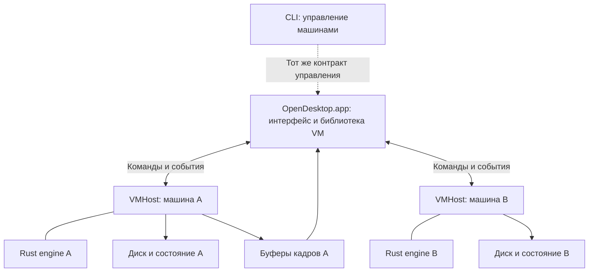

# Open Desktop: предлагаемая архитектура и стек

Статус: предложение для принятия архитектурных решений. Дата: 22 октября 2026 года.

Цель — приложение macOS класса Parallels Desktop с собственным исполнением полноценных x86-64 гостевых ОС на Apple Silicon. Готовые сторонние реализации эмуляции, декодирования инструкций, JIT, прошивки и графической трансляции не используются; библиотеки общего назначения разрешены. Предложение продолжает `docs/ROADMAP.md`; реализация приложения в текущем проекте ещё не начата.

## 1. Рекомендация

**SwiftUI + AppKit для приложения, Rust для движка, Metal для изображения и графики, отдельный процесс на каждую VM.** Внутри процесса VM системный host-слой обращается к Rust через небольшой C ABI. Декодер, интерпретатор, IR, ARM64 emitter, MMU и модели устройств — собственные.

Главные основания выбора:

- Нативный интерфейс macOS с прямым доступом к системным возможностям.
- Отдельная от интерфейса библиотека движка, которую можно запускать и проверять без GUI.
- Контроль над представлением состояния CPU, памятью и генерируемым кодом.
- Локализация небезопасных операций с памятью в небольшом числе модулей.
- Независимые процессы VM: сбой одного движка не закрывает библиотеку машин.

Использование Rust не устраняет ошибки модели x86 или JIT. Корректность архитектуры обеспечивают собственные тесты и независимый физический x86-стенд.

Компиляторы, стандартные библиотеки, SDK, системные framework и библиотеки общего назначения разрешены. В частности, компиляция исходников Rust компилятором с LLVM backend допустима; использование LLVM как библиотеки нашего runtime-транслятора исключено. Нормативные правила и порядок проверки записаны в [политике зависимостей](policies/DEPENDENCIES.md), уточнение согласовано в [ADR-0002](decisions/ADR-0002-general-purpose-libraries.md).

## 2. Стек по слоям

| Слой | Предлагаемый стек | Ответственность |
|---|---|---|
| Интерфейс | Swift, SwiftUI, AppKit | Библиотека VM, настройки, мастер создания, окна и команды пользователя |
| Отображение VM | AppKit view, Metal, позднее IOSurface | Кадры, курсор, масштабирование, DPI и несколько экранов |
| Управление запуском | Swift/Foundation и системные process API | Создание отдельного процесса VM, мониторинг, завершение, обработка сбоев |
| Host-оболочка процесса VM | Swift, при необходимости небольшой C/Objective-C слой | IPC, жизненный цикл, системные ресурсы и мост к движку |
| Ядро машины | Rust, stable toolchain | CPU, MMU, vCPU, устройства и события |
| Транслятор | Rust, собственный IR и ARM64 emitter | x86 decode, lowering, регистры, блоки и JIT-кеш |
| Низкоуровневые механизмы | Изолированные Rust `unsafe`, C ABI и небольшой ARM64 assembly | Исполняемая память, вход/выход JIT, атомарные операции и host context |
| Диск | Rust, системные файловые API | RAW вначале, затем собственный CoW-формат |
| Ввод/звук/сеть | AppKit, CoreAudio, BSD sockets и собственные модели устройств | Связь виртуального оборудования с macOS |
| Windows guest agent | C++20, Win32 SDK | Буфер обмена, обмен файлами, время, управление гостем |
| Windows kernel drivers | C, WDK; ограниченный C++ только при обосновании | Дисплей, интеграция и собственные виртуальные устройства |
| UEFI | Собственный freestanding Rust/C и небольшой x86 assembly | Загрузка гостя и необходимые firmware-интерфейсы |
| Linux guest tools | C/Rust userspace; C для собственных kernel-модулей при необходимости | Интеграция с гостевой Linux |
| Сборка | Cargo workspace + Xcode; отдельная Windows-сборка WDK | Библиотеки, приложение, подпись, гостевые компоненты |
| Проверка | Rust test harness, Swift Testing/XCTest, собственный x86 runner | Корректность CPU, устройства, UI и совместимость |
| Диагностика | Собственные структурированные события, OSLog, Instruments | Производительность, причины остановки и воспроизведение ошибок |

Общие библиотеки логирования, конфигурации, сериализации, коллекций, синхронизации, асинхронной инфраструктуры и bindings системных API допустимы при реальной необходимости. Конкретные пакеты этим документом не выбираются. Собственные контракты ABI/IPC и ключевые компоненты движка не заменяются готовыми реализациями; библиотека кодирования сообщений не определяет за нас wire format и его семантику. Генерация собственных таблиц и заголовков из собственных схем допустима. На критичных участках выбор инфраструктуры подтверждается замерами.

## 3. Границы процессов



### Приложение

Хранит каталог машин и пользовательские предпочтения, создаёт окна, отправляет команды и показывает состояние. Оно не исполняет гостевой CPU и не изменяет диск работающей VM напрямую.

Приложение использует обычные Swift-модели и локальное состояние представлений. Отдельный глобальный framework управления состоянием на старте не нужен. Состояние выполняющейся машины приходит из процесса VM; GUI не должен независимо угадывать, запущена она или остановлена.

### VMHost — один экземпляр на машину

Владеет экземпляром движка, JIT-памятью, файлами диска и активными host-ресурсами. Связывается со статической Rust-библиотекой через C ABI. Внутри Rust `od-machine` отвечает за RAM/backing и их mapping lifecycle, MMU translation/permissions и связанные guest-memory effects; VMHost владеет временем жизни всей машины, но не подменяет этот owner универсальным буфером. Отдельного IPC между VMHost и Rust нет.

Внутри VMHost находится один экземпляр машины. После фатального сбоя процесс завершается, а приложение предлагает восстановление. Перезапуск процесса не должен автоматически повторять потенциально разрушающую данные операцию.

### Нужен ли центральный сервис

На старте достаточно приложения и дочерних VMHost. Постоянный daemon, привилегированный helper и фоновая работа после выхода из приложения не требуются для первого продукта.

Сначала выход из приложения предлагает остановить или сохранить активные машины. Если позже потребуется их независимая фоновая жизнь, добавить отдельный непривилегированный supervisor с восстановлением соединений. Это изменение жизненного цикла, которое нужно вводить осознанно.

## 4. IPC: управление отдельно от потока данных

### Первая реализация

Для control plane предлагается **унаследованный Unix socketpair**. Приложение запускает отдельный VMHost, явно передавая нужный дескриптор при создании процесса. Это позволяет получить модель «процесс на машину» без выбора имени глобального сервиса.

Собственный протокол небольшой: заголовок с версией и длиной, тип сообщения, идентификатор запроса, поля с ограничениями размеров. Команды: create/configure, start, pause, resume, stop, save и query. События: переход состояния, прогресс, ошибка и агрегированная статистика.

Нужны согласование версий, обработка разрыва соединения, таймауты операций и правила повторов. Например, повтор команды создания снимка с тем же request ID не должен создавать второй снимок. Парсер не должен принимать неограниченные длины, дескрипторы или пути.

### Где подходит XPC

XPC полезен для интеграции с системными сервисами, проверки идентичности подключающегося процесса и передачи некоторых macOS-ресурсов. Однако именованный XPC service сам по себе не определяет модель «отдельный экземпляр на каждую VM».

Если XPC будет выбран как основной транспорт, сначала нужно подтвердить запуск нескольких отдельных helper-процессов и bootstrap отдельных endpoints в подписанной сборке. Контракт команд должен оставаться независимым от транспорта. [Apple: создание XPC services](https://developer.apple.com/documentation/xpc/creating-xpc-services).

### Кадры, звук и интенсивный ввод

Кадры не передаются сериализованными control-сообщениями. Начальный путь: разделяемый framebuffer с несколькими слотами, номером поколения и явным владением буфером. UI получает уведомление, читает готовый слот и загружает изображение в Metal texture. Копирование на этом этапе допустимо и измеряется.

Позднее — IOSurface и передача соответствующих системных handles с корректной синхронизацией. IOSurface является средством обмена изображениями, а не обещанием отсутствия копий во всём графическом тракте. [Apple: IOSurface](https://developer.apple.com/documentation/iosurface).

Очереди звука и событий ввода имеют ограниченную ёмкость и отдельную политику переполнения. Логи и статистика агрегируются: запись события на каждую гостевую инструкцию не входит в нормальный режим.

## 5. Устройство собственного движка

Начальная структура — **модульная библиотека**, без микросервисов и отдельных процессов для CPU, MMU и каждого устройства.

### CPU state и собственный декодер

`CpuState` содержит архитектурное состояние гостя: регистры, флаги, режим, сегменты, control registers, MSR, векторное состояние и pending events. Представление не должно зависеть от расположения значений в host-регистрах.

Декодер получает байты через интерфейс чтения гостевой памяти. Он не предполагает, что следующие 15 байт инструкции доступны одной непрерывной host-ссылкой. Результат декодирования не содержит необоснованных доступов за границы страницы.

На старте описания инструкций и таблицы поддерживаются вручную или генерируются из собственных исходных спецификаций проекта. Автоматическая генерация не заменяет независимую проверку семантики.

### Интерпретатор и JIT

Интерпретатор должен появиться первым и оставаться доступным как режим диагностики. JIT использует тот же архитектурный контракт, но результаты обоих проверяются на физическом x86. Общий ошибочный helper может одинаково ошибаться в обоих путях.

Предлагаемый конвейер:

**Fetch → Decode → Guest IR → упрощение → Lowering ARM64 → распределение регистров → код и карты состояния → публикация блока.**

Первый IR — типизированный и небольшой: целочисленные операции, flags, guest load/store, атомарность, исключения, переходы и фиксация состояния. Сложный глобальный SSA-оптимизатор не нужен до рабочего block JIT. Память и её порядок нельзя потерять при lowering: обычный load, MMIO и атомарная операция имеют разные правила.

Начать с простого аллокатора регистров, затем перейти к linear scan, когда измерения покажут цену spill. Для сложных редких инструкций допустим вызов собственного интерпретатора или helper.

### JIT runtime

Владеет исполняемой памятью, dispatcher, кешем блоков и связями между ними. Ключ блока учитывает не только RIP, но и необходимый контекст декодирования/исполнения и версии соответствующих страниц.

Обязательны карты соответствия host PC гостевой инструкции, восстановление точного состояния при исключении, инвалидация изменённого кода и безопасное освобождение блоков при SMP. Снимок машины не хранит host-адреса JIT: код пересоздаётся после восстановления.

Исполняемую память и режимы записи в неё оформить отдельным macOS-модулем и проверить вместе с подписью/Hardened Runtime в самом начале. Точная комбинация поддерживаемых JIT API выбирается для минимальной версии macOS. [Apple: JIT на Apple Silicon](https://developer.apple.com/documentation/apple-silicon/porting-just-in-time-compilers-to-apple-silicon).

Границы исполнения разделены по владельцам: `od-machine` разрешает guest fetch/data accesses и сообщает о committed writes; `od-jit` декодирует, компилирует, dispatch-ит и инвалидирует code dependencies; `od-host` публикует executable artifact и удерживает executable mapping на срок исполнения/разбора результата в обычных one-shot API. Bounded S3-18e/f fixture реализует узкий opt-in typed retained-handle путь для трёх явно ограниченных memory-pair профилей: `od-jit` владеет cache key/policy, а `od-host` — code-only mapping и неизменяемыми метаданными до eviction/clear/drop. Такой handle не удерживает invocation-local CPU, RAM, helper, STOP или event pointers; текущие одновызовные API сохраняют прежний срок жизни. Допуск S3-18f ограничен точным Load→Load профилем S3-26e и сохраняет два отдельных чтения и отказ Store→Store. Это не production owner/MMU integration и не решает общий lifetime-контракт; граница описана в [ADR-0004](decisions/ADR-0004-capacity-one-memory-cache.md). `od-jit` не зависит от `od-host`, а `od-machine` не переносит host executable-memory policy в MMU.

### Память и MMU

Разделять три понятия: гостевой виртуальный адрес, гостевой физический адрес и host-адрес. Использовать разные внутренние типы, чтобы не смешивать их в API.

Программный TLB, проверка прав и перевод адреса принадлежат движку. RAM имеет быстрый путь; MMIO передаётся модели устройства. В горячем пути нет обращения к Swift, IPC или универсального сериализатора.

Feature-gated `MutableTranslationProbeSession` — ограниченный diagnostic prototype:
он эксклюзивно заимствует единственный `PhysicalMemory`, хранит одну успешную
pure translation как value и разрешает aligned PTE-sized writes через checked
memory API. Запись сама по себе не сбрасывает запись cache. Точный standalone
INVLPG fetch использует pure probe в обход resident entry; retired effect
потребляется синхронно и очищает entry до следующего lookup. Этот опыт не
заменяет tracked A/D access, production TLB, guest-store integration или
concurrent memory ownership; ссылки и access handles из сессии не выдаются.

Модель x86-TSO, гарантии классов доступа, atomicity и контракт host-кандидатов определяет [спецификация модели памяти S6-04](specs/MEMORY_MODEL.md). Нельзя выдавать долгоживущие Rust `&mut` на память, которую одновременно меняют JIT, DMA или другой vCPU. Нужны проверяемые правила для raw accesses, атомарных операций, барьеров и остановки мира. Один `UnsafeCell` лишь разрешает внутреннее изменение через shared reference: он не отменяет уникальность активного `&mut`, не синхронизирует потоки и не предотвращает data race. Начать с одного vCPU и явно синхронизированного I/O, расширяя модель до SMP после проверки.

Ошибки гостевой памяти — значения результата и гостевые исключения, а не host `panic`. Проверять пересечения страниц и несовпадение размеров host/guest pages.

### Планирование и устройства

Сначала один vCPU и очередь виртуальных событий. Далее один поток на активный vCPU и ограниченное количество I/O workers. Асинхронный runtime общего назначения для исполнения CPU не нужен.

Устройства получают bus access и события, а не произвольные ссылки на все внутренние структуры VM. Для редких конфигурационных операций допустимы traits и динамическая диспетчеризация; на каждом доступе к обычной RAM она не требуется.

Виртуальное время, TSC и доставка таймеров должны иметь явную политику при pause, suspend и sleep/wake Mac. «Режим воспроизведения» проектируется отдельно: одинаковое виртуальное время само по себе не обеспечивает детерминизм при SMP и внешнем I/O.

## 6. Граница Swift ↔ Rust

Использовать узкий **C ABI со скрытыми handles**, кодами результата и явно заданным владением буферами. На границе фиксируются версия ABI, допустимые потоки вызова и срок жизни объектов. Структуры, передаваемые по значению, имеют подходящее C-совместимое представление; Rust `String`, `Vec` и внутренние enum через границу не передаются.

Swift вызывает операции высокого уровня: создать машину, запустить, запросить состояние, передать host-событие, остановить. Rust отдаёт события через очередь или ограниченные callbacks вне горячего пути.

Rust panic и исключения других языков не должны пересекать ABI. Для production допустима политика завершения только VMHost при внутренней фатальной ошибке. `catch_unwind` не является механизмом восстановления после повреждения памяти. Требования к ABI и unwinding описаны в официальном Rustonomicon. [Rust: FFI](https://doc.rust-lang.org/stable/nomicon/ffi.html).

## 7. Диски, конфигурация и снимки

### Каталог VM

Машина хранится самостоятельным bundle-каталогом с конфигурацией, дисками, firmware state, TPM state, снимками и логами. Каталог машин в UI — восстанавливаемый индекс; он не является единственным местом хранения критических данных.

Конфигурацию UI можно хранить в versioned plist средствами Foundation. Движок получает уже проверенную конфигурацию через ABI; ему не требуется собственный XML/plist parser. Для сохранения используют атомарную замену и проверку версии схемы.

### Диск

Сначала RAW с явной семантикой flush и единственным владельцем. Затем собственный CoW-формат: versioned superblock, таблица блоков, метаданные снимков, crash-consistent транзакции и инструменты проверки/восстановления.

Запуск двух VMHost с одним writable-диском блокируется. Формат диска проектируется отдельно от структуры RAM: Rust layout не становится дисковым форматом. Для первой версии не нужны QCOW2/VMDK и их parsers; при необходимости импортировать позднее, начиная с простого RAW.

### Снимки

Снимок — архитектурное состояние CPU, RAM, устройств, времени, I/O и постоянного firmware/TPM состояния с версией. Перед записью нужен согласованный barrier между vCPU и I/O. JIT-кеш не является обязательной частью снимка.

Pause, RAM suspend, disk-only snapshot и согласованный guest snapshot — разные операции с разными гарантиями. Их нельзя объединять под одной кнопкой без явной семантики.

## 8. Гостевые компоненты и графика

С самого начала разделить три части:

1. Модель виртуального устройства внутри host-движка.
2. Гостевой драйвер для этого устройства.
3. Host backend, использующий системные возможности macOS.

Например, у графики это virtual GPU, WDDM driver и Metal renderer. Отображение framebuffer в Metal не означает реализацию ускоренного Direct3D.

Первый дисплей — простой framebuffer/GOP. Следующий этап — собственный display-only driver для изменения разрешения, курсора и нескольких экранов. Для 3D нужны соответствующие user-mode/kernel-mode части драйвера, собственный протокол ресурсов, синхронизация и шейдерный перевод. [Microsoft: WDDM](https://learn.microsoft.com/en-us/windows-hardware/drivers/display/windows-vista-and-later-display-driver-model-architecture).

Windows agent выполняет операции уровня пользователя и не получает ненужных kernel-привилегий. Начальный канал — собственный небольшой протокол поверх виртуального serial/PCI transport; быстрый shared-memory transport добавляется позднее. Протокол имеет версии и ограничивает размеры, очереди и доступные операции.

Прошивка и guest drivers собираются отдельно от macOS-библиотеки: у них другие target, ABI, ограничения runtime и тестирование. Windows kernel-компоненты разумно начинать на C/WDK, не связывая весь проект с готовностью Rust-инструментов для драйверов.

## 9. Репозиторий и сборка

Каталоги и библиотечный каркас созданы по отдельному поручению пользователя. Нормативная подробная карта и правила размещения находятся в [PROJECT_LAYOUT.md](PROJECT_LAYOUT.md). Ниже — обзор компонентов; наличие каталога не означает реализацию подсистемы:

```text
open_desktop/
  apps/macos/                 Swift UI и окна VM
  apps/vmhost/                Host-процесс и системная интеграция
  crates/od-isa/              CPU state, decoder, interpreter
  crates/od-jit/              IR, ARM64 emitter, JIT runtime
  crates/od-machine/          MMU, bus, устройства, scheduler
  crates/od-uefi-security/    общие форматы и проверка UEFI Secure Boot
  crates/od-storage/          Диски и снимки
  crates/od-host/             Host ABI и macOS memory/I/O primitives
  crates/od-testkit/          Собственные генераторы и сравнение
  include/                   Публичный C ABI
  protocols/                 Спецификации IPC и гостевых устройств
  firmware/                  Собственная UEFI
  guest/windows/             Agent и драйверы
  guest/linux/               Гостевые компоненты
  tools/                     Runner, image tools, диагностика
  tests/                     CPU, системные и продуктовые сценарии
  docs/                      Roadmap, архитектура и решения
```

Стрелки зависимостей контролируются: `od-isa` не зависит от AppKit или виртуального диска; `od-jit` знает архитектурный контракт и интерфейсы runtime; `od-machine` связывает CPU, память и устройства. Связь JIT с гостевой памятью задаётся узким runtime-интерфейсом, а не циклической зависимостью crates. `od-host` реализует host-примитивы, а не становится сборником всей бизнес-логики.

Для первого прототипа использовать только необходимые части созданного каркаса и headless runner. Шесть зарезервированных host-библиотек пока содержат только документацию. Дополнительные crates появляются при сформировавшейся границе ответственности; наличие всех каталогов не требует реализовывать их одновременно.

Cargo отвечает за Rust, Xcode — за app/helper, entitlements, подпись и notarization. Небольшой собственный build driver объединяет шаги и проверяет версии toolchain. Windows drivers строятся на Windows с WDK; firmware — для собственного freestanding target. Не вводить сразу Bazel, сложную многоязычную генерацию или собственный package manager.

## 10. Проверка архитектурных решений

До разработки большого GUI подтвердить четыре вертикальных сценария (две нижние строки таблицы — срезы этапа 7 с фактическим статусом на 2026-11-21, а не обязательные сценарии до GUI):

| Проверка | Что она доказывает |
|---|---|
| Headless runner исполняет x86-последовательность через interpreter и JIT | Движок не зависит от интерфейса и имеет проверяемую семантику |
| Подписанный VMHost генерирует ARM64 и завершается по команде | Работают процессная модель, ABI и JIT в конфигурации поставки |
| Два VMHost работают одновременно; один аварийно завершается | Процессы и ресурсы действительно разделены |
| Framebuffer из VMHost отображается в окне и меняет размер | Проверены начальные IPC, синхронизация буферов и Metal presentation |
| Собственная прошивка загружает собственное EFI-приложение с ESP при включённом Secure Boot и measured boot (плановая строка S7-41) | Подтверждается тремя тестами совместно: [`firmware_esp_boot_smoke.py`](../tests/system/firmware_esp_boot_smoke.py) (загрузка с NVMe ESP, `BootOrder`/`BootNext`), [`firmware_secure_boot_smoke.py`](../tests/system/firmware_secure_boot_smoke.py) (SetupMode, enrollment, UserMode, подписанное приложение, отзыв `dbx`, холодный запуск), [`firmware_tpm_smoke.py`](../tests/system/firmware_tpm_smoke.py) (CRB, TCG2, лог Event03, replay PCR0/1/4/5, запуск из FV и с ESP); сквозной replay PCR0–7 для сценариев Secure Boot — ignored-тест `firmware_secure_boot_pcr7_replays_setup_enrollment_and_revocation` в единой проверке. **Статус:** зелёный прогон 16 из 16 шагов на `main` `991dc01` (одна машина, один прогон); собственные тестовые приложения и ключи, не Windows и не Linux-дистрибутив; итоговое ревью S7-40 принято с замечаниями 2026-11-21; G4–G6 приняты по задачам и S7-40 (решение Opus high a6e76969), отдельное ревью gate не проводилось. [Отчёт этапа 7, раздел 0](reports/STAGE_7_REPORT.md#0-итог-этапа-и-приёмка-ступеней-16-s7-41-2026-11-21) |
| Linux загружается до `/init` через собственную UEFI | **Достигнуто, не принято:** ядро Ubuntu 7.0.0-38 доходит до `/init` на диагностической единой плате «UEFI + Linux» ([S7-31m](reports/STAGE_7_REPORT.md#s7-31m--issue-640-прерывание-таймера-в-простое-hlt-единого-цикла-init-достигнут-2026-11-21)); измерительные скрипты `tests/system/firmware_linux_uefi_stop_record.py` и `firmware_linux_uefi_efivars_acpi.py` (в единую проверку прошивки не входят). **Открыто:** значения переменных через `efivarfs` (имена видны, S7-31n), строки ACPI-диагностики уровня 4 (ELCR, [ISSUE-643](KNOWN_ISSUES.md#issue-643)), RTC ([ISSUE-641](KNOWN_ISSUES.md#issue-641)), приёмка плана S7-31. Загрузка установочного образа Windows через собственную UEFI не проверялась (S7-32 пропущена по решению владельца 2026-11-21) |

Далее добавить проверки точных исключений, дисковой аварийной устойчивости, границ IPC, ограничений доступа к общим папкам и безопасного обновления bundle. Это проверки конкретных границ системы, а не повод откладывать CPU-разработку до большой инфраструктуры.

## 11. Альтернативы и выбор

| Вариант | Когда подходит | Основная цена |
|---|---|---|
| **Swift + Rust — рекомендация** | Команда готова писать CPU/JIT на Rust и хочет ограничить небезопасные участки | Нужны строгий ABI, опыт low-level Rust и отдельный WDK-стек |
| Swift/AppKit + C++ + Objective-C++ | Сильная команда C++ с опытом VM, компиляторов и Windows drivers | Больше ручной работы с владением, памятью и конкурентностью |
| Swift для всего host-продукта и движка | Команда существенно сильнее в Swift; это подтверждено CPU-прототипом | Нужно отдельно доказать удобство контроля памяти, JIT-runtime и переносимости стендов |

Производительность не определяется названием языка. Для этого проекта важнее стоимость MMU, модель памяти x86, качество блоков и управление переходами. Выбор Rust делается ради структуры и контролируемых границ памяти, а не как обещание автоматического ускорения.

**Предлагаемое решение сейчас:** принять Swift + Rust, запускать по VMHost на машину, сохранить headless runner основным инструментом разработки и сначала реализовать вертикальный путь «x86-код → собственный JIT → ARM64» в подписанном helper. GUI, firmware и GPU развивать вокруг уже проверенных контрактов.
