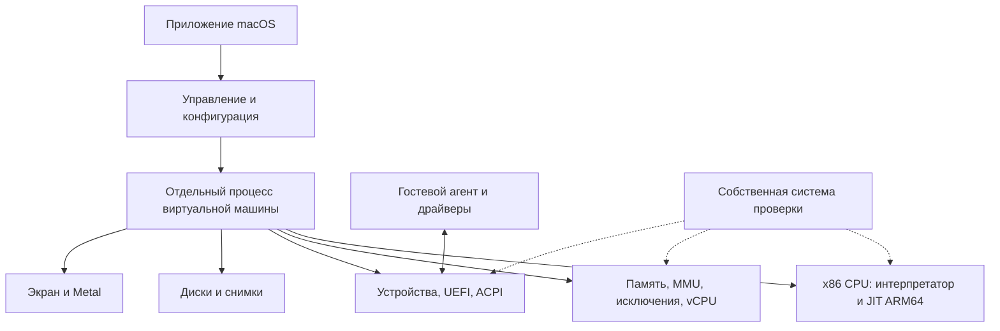

# Roadmap: собственная x86-64 платформа для macOS на Apple Silicon

**Цель:** создать настольный продукт класса Parallels Desktop, который запускает полноценные x86-64 Windows и Linux на Apple Silicon с помощью собственного динамического транслятора.

**Ограничение:** движок, декодер, промежуточное представление, генератор ARM64, модели оборудования, прошивка, гостевые компоненты и графический мост разрабатываются самостоятельно. Готовые сторонние реализации этих компонентов не используются. Библиотеки общего назначения разрешены по [политике зависимостей](policies/DEPENDENCIES.md).

**Дата планирования:** 22 октября 2026 года. Сроки ниже отсчитываются от начала проекта.

## 1. Масштаб и конечный результат

Это разработка собственной вычислительной платформы и настольного продукта вокруг неё. Транслятор — центральная, но только одна из нескольких больших подсистем.

У Parallels нужно разделять два ориентира. Быстрый сценарий Windows на Apple Silicon использует Windows on Arm; x86/x64 приложения могут исполняться через механизмы самой Windows. Отдельно Parallels предлагает эмуляцию полноценных Intel VM и документирует существенные ограничения её производительности. Поэтому скорость ARM-виртуализации нельзя автоматически переносить на наш проект. [Parallels: Windows на Apple Silicon](https://kb.parallels.com/us/125375), [Parallels: x86 emulator](https://kb.parallels.com/en/130217).

Предлагаемое позиционирование первой коммерческой версии: **запуск нужных пользователю x86-64 систем и программ на Mac с понятной совместимостью, надёжными дисками и удобной интеграцией**. Конкуренция по всему набору функций Parallels — долгосрочная цель.

### Три уровня готовности

| Уровень | Что получает пользователь | Что подтверждает готовность |
|---|---|---|
| Технологический прототип | Исполнение x86-кода, затем загрузка одной Linux | Проверяемая корректность CPU, памяти и базовой машины |
| Коммерческая версия для выбранных задач | Конкретная Windows x64, установка приложений, сеть, файлы, звук, восстановление состояния | Приёмка на заранее выбранном наборе реальных рабочих сценариев |
| Продукт класса Parallels | Ускоренная графика, несколько дисплеев, удобные окна приложений, зрелая интеграция, управление и поддержка | Длительная эксплуатация, широкая матрица приложений и предсказуемые обновления |

Полная эмуляция x86 даёт возможность исполнять гостевой x86-код ядра и драйверов. Это не означает автоматическую совместимость любого драйвера: ему ещё требуется соответствующее виртуальное устройство либо реализованный проброс физического оборудования.

## 2. Что означает «с нуля»

### Пишем самостоятельно

- Декодер x86, семантику инструкций и эталонный интерпретатор.
- Собственное промежуточное представление и генератор ARM64 без LLVM.
- Управление переведённым кодом, регистровый аллокатор, оптимизации, обработку исключений.
- MMU, программный TLB, модель памяти, прерывания и планирование vCPU.
- Шину, устройства, гостевую прошивку UEFI и таблицы ACPI для нашей виртуальной машины.
- Формат диска и снимков, управление машиной, гостевой агент и необходимые драйверы.
- Графический протокол и перевод поддерживаемых графических операций в Metal.

QEMU, TCG, FEX, Box64, Unicorn, Bochs, Capstone, Zydis, Intel XED, LLVM, OVMF/EDK II, SeaBIOS, готовые virtio-драйверы, DXVK и vkd3d не входят в реализацию. Публичные спецификации интерфейсов использовать можно; их реализацию пишем сами.

### Разрешённая основа

Разрешены компиляторы, стандартная библиотека языка, macOS SDK, системные API, штатные компоненты гостевой ОС и общие библиотеки инфраструктуры: логирование, CLI, конфигурация, сериализация, коллекции, синхронизация, async, системные bindings и инструменты тестирования. SwiftUI/AppKit, Metal, файловые и сетевые API macOS, системная криптография, инструменты подписи и Windows SDK/WDK допустимы. Это граница проекта: мы не разрабатываем собственную macOS, компилятор языка или криптографические примитивы.

Самостоятельность относится к ключевой технологии, а не ко всей вспомогательной инфраструктуре. В частности, vTPM и Secure Boot используют собственную логику протоколов поверх системных криптографических API или общих библиотек примитивов. Форматы, семантика и ограничения наших протоколов остаются проектными. Добавление общей библиотеки на критичном участке требует замеров.

Гостевые Windows/Linux являются запускаемой средой. Их штатные загрузчики, приложения и системные драйверы не считаются переиспользованием стороннего движка.

## 3. Первая поддерживаемая конфигурация

| Параметр | Начальная граница |
|---|---|
| Хост | macOS на Apple Silicon; две конкретные версии macOS и несколько моделей Mac выбираются в начале |
| Гость для отладки | Одна зафиксированная сборка Linux x86-64, сначала без графического окружения |
| Коммерческий гость | Одна зафиксированная редакция и сборка Windows 11 x64; требования к CPU проверяются на этапе 0 |
| CPU | Собственный документированный профиль CPUID с согласованным набором возможностей |
| Число процессоров | Один vCPU сначала, затем 2–4; расширение после проверки SMP |
| Загрузка | Прямая загрузка Linux для разработки, затем собственный путь UEFI |
| Диск | RAW для прототипа, собственный формат copy-on-write для продукта |
| Экран | Простой framebuffer, затем собственный дисплейный драйвер и ускорение |
| Устройства | Минимальный фиксированный набор с предсказуемыми драйверами |
| Распространение | Подписанное и нотарифицированное приложение; пригодность выбранной упаковки проверяется рано |

В первую версию не включаем: Intel macOS, запуск произвольных старых BIOS-образов, nested virtualization, универсальную совместимость с anti-cheat/DRM, GPU passthrough, все разновидности USB, DirectX 12, поддержку всех форматов чужих VM.

Исключение функции из первой версии не означает её невозможность. Это управление объёмом работы. Необходимые отдельным приложениям инструкции, например AVX2, могут быть подняты в приоритете после выбора целевых сценариев.

## 4. Архитектура

Предлагаемый стек: **Rust для ядра и моделей устройств, небольшой слой обращения к системным ABI, Swift/AppKit или SwiftUI для приложения**. C++ также подходит; важнее выбрать один основной язык ядра и не поддерживать параллельные реализации.

Каждая VM работает отдельным процессом. Сбои гостя и драйверов не должны закрывать библиотеку машин. У протоколов управления, устройств и снимков с начала есть версии. Переведённые блоки считаются производным кешем: после восстановления снимка их можно пересоздать.

Hypervisor.framework не используется как исполнитель x86-кода. Дополнительный ARM backend допустим только как отдельное будущее направление и не входит в критический путь этого roadmap.

## 5. Этапы разработки и критерии перехода

Этапы задают зависимости. После формирования стабильных интерфейсов часть работы идёт параллельно внутри команды. Приведённые длительности ориентировочные и не складываются механически.

### Этап 0. Технический контракт и проверка жизнеспособности

**Ориентир:** первые 4–6 недель, 3–5 ключевых инженеров.

Результат:

- Выбраны гостевые ОС, приложения и модели Mac для первой поддержки.
- Описан профиль CPU: инструкции, режимы, CPUID, исключения, модель памяти.
- Составлен список требований выбранной Windows, её загрузчика и штатных драйверов.
- Зафиксированы разрешённые системные зависимости и происхождение собственного кода.
- Выбрана виртуальная плата: шина, контроллер диска, сеть, экран, прерывания.
- Созданы прототипы выделения исполняемой памяти, генерации ARM64 и обработки сбоев на macOS.
- Проверено, что этот механизм работает в подписанной сборке с планируемыми runtime-настройками.
- Определены тестовый парк Intel/AMD и Apple Silicon и способ воспроизведения ошибок.

Apple отдельно документирует требования JIT на Apple Silicon и взаимодействие с Hardened Runtime. Это проверка первого этапа, поскольку успешная работа из среды разработки ещё не подтверждает пригодность распространяемой сборки. [Apple: перенос JIT](https://developer.apple.com/documentation/apple-silicon/porting-just-in-time-compilers-to-apple-silicon).

**Критерий:** утверждены архитектура, границы совместимости и набор измеримых сценариев; небольшой собственный JIT работает в предполагаемой конфигурации поставки.

### Этап 1. Основа проверки корректности

**Ориентир:** месяцы 1–4; далее развивается постоянно.

Пошаговая реализация и приёмка: [план этапа 1](plans/STAGE_1.md). Первый физический x86-стенд — единственный доступный Mac mini с Ubuntu; сведения о доступе и границах проверки находятся в плане и [описании стенда](testing/STAND.md).

Создать собственные:

- S0-12/E03 закрыт в Stage 1 для register-only S0-09 профиля: безопасный runner исполнил ручные и seeded fixtures на физическом Mac mini, результаты сравнены с interpreter/JIT на M3 Max и сохранены в [отчёте Stage 1](reports/STAGE_1_REPORT.md). Полная ISA и другие x86 модели этим не подтверждаются.
- Генератор тестовых последовательностей и загрузчик тестовых программ.
- Снимок архитектурного состояния CPU: регистры, флаги, память и исключения.
- Нативный исполнитель тестов на физических x86-машинах.
- Сравнение результатов, сокращение упавшего примера и воспроизводимую запись ошибки.
- Тесты для границ страниц, недопустимых инструкций, переполнений и адресных режимов.
- Генератор проверок моделей устройств и обработчиков протоколов.

После появления воспроизводимого CLI и машиночитаемых результатов рассмотреть локальный MCP-сервер (Model Context Protocol) для инструментов разработки: запуск тестовой фикстуры, сравнение состояний и чтение отчёта о сбое. Он должен использовать существующий проверяющий стенд; самостоятельный протокол управления VM или зависимость движка от MCP для этого не нужны. Решение о реализации принять по пользе в реальных сценариях проверки.

Сравнивать нужно определённое архитектурой поведение. Неопределённые флаги и допустимые различия моделей CPU нельзя превращать в ложные ошибки. Опасные и привилегированные сценарии проверяются отдельным собственным bare-metal стендом на выделенной x86-машине.

**Критерий:** для новой группы инструкций есть автоматическая проверка на физическом x86; ошибка воспроизводится маленьким тестом. Независимый проверяющий путь существует до активной оптимизации.

### Этап 2. Эталонный интерпретатор x86-64

**Ориентир:** месяцы 2–9, с дальнейшим расширением.

Пошаговая реализация, зависимости от системной памяти и критерии приёмки: [план этапа 2](plans/STAGE_2.md). План опирается на принятый проверяющий стенд этапа 1 и разделяет готовность отдельных срезов и всего выбранного CPU-профиля.

Порядок реализации:

1. Декодирование префиксов, ModR/M, SIB, immediate и адресов.
2. Целочисленные инструкции, переходы, стек и флаги.
3. Строковые инструкции и повторения, точные прерывания их выполнения.
4. Поддержка режимов и переходов между ними по потребностям выбранного пути загрузки.
5. Системные инструкции, сегментация, MSR и исключения.
6. x87, MMX, SSE/SSE2 и дополнительные расширения выбранного профиля.

Не объявлять через CPUID возможности, чья семантика ещё не реализована. Более новые инструкции не всегда можно просто скрыть: базовые требования выбранной ОС и приложений определяют минимальный профиль.

x87 требует собственной корректной модели расширенной точности, округления и исключений. Простая замена на host `double` не является универсальным решением.

**Критерий:** поддерживаемый набор исполняется корректно на граничных случаях и с ожидаемыми исключениями. Интерпретатор остаётся режимом диагностики и эталоном для JIT.

### Этап 3. Первый JIT x86 → ARM64

**Ориентир:** месяцы 4–12; начинается до завершения всей ISA.

Пошаговая реализация IR, ARM64 runtime, кеша и инвалидации, а также проверки и замеры: [план этапа 3](plans/STAGE_3.md). Поддержка новых форм зависит от подтверждённой семантики интерпретатора и физического проверяющего стенда.

Отдельная линия доработки ядра — устранение дублирования допуска и сборки блока по формам, одна точка входа диспетчера для регистрового набора, вывод этого пути на существующий multi-entry кеш и interpreter fallback, измерения в сопоставлении с записанными cold/warm числами: [план доработки ядра этапа 3](plans/STAGE_3_CORE.md). Линия не добавляет инструкций и кодировок и ведётся параллельно активной линии этапа 4, потому что не трогает `crates/od-isa` и `crates/od-machine`.

Реализовать:

- Собственное промежуточное представление с явными операциями над состоянием x86.
- Генерацию ARM64, временные значения и первоначально простой регистровый аллокатор.
- Перевод базовых блоков и кеш поиска блоков.
- Переходы между блоками, возврат в dispatcher и вызовы вспомогательных функций.
- Вычисление флагов по необходимости с возможностью восстановить точное состояние.
- Соответствие host PC и гостевой инструкции для исключений, отладки и остановки.
- Безопасную публикацию, изменение и удаление кода; синхронизацию кеша инструкций.
- Инвалидацию при записи в исполняемую память.

Первый JIT покрывает ограниченное подмножество, а остальные поддерживаемые инструкции передаёт собственному интерпретатору. Для редких сложных инструкций допустимы собственные helper-функции.

**Критерий:** одинаковые программы дают одинаковое определённое состояние в интерпретаторе, JIT и на физическом x86. Ускорение измерено раздельно для первого исполнения и прогретого кеша.

### Этап 4. Системная память, прерывания и машина с одним CPU

**Ориентир:** месяцы 6–15; начинается параллельно с JIT.

Пошаговая реализация, зависимости и критерии приёмки: [план этапа 4](plans/STAGE_4.md).

Реализовать:

- Гостевую физическую память и отображение MMIO.
- x86 paging для выбранных режимов, права доступа и программный TLB.
- Точные page fault: адрес, код ошибки, порядок проверок и состояние CPU.
- CR0/CR3/CR4, EFER, дескрипторы, IDT/GDT и переходы привилегий.
- Инвалидацию адресных переводов при изменениях гостевой памяти и регистров.
- Прерывания, APIC/IOAPIC, нужные таймеры и модель виртуального времени.
- Базовую PCI/PCIe-конфигурацию, UART и способ загрузки тестового ядра.

Учитывать несовпадение размера страниц гостя и хоста: нельзя строить MMU на предположении «одна гостевая страница равна одной host-странице». Отдельно проверить доступы, пересекающие страницы, и точное восстановление частично выполненных операций.

**Критерий:** собственное тестовое ядро проходит проверки памяти и прерываний; выбранная Linux достигает userspace через документированный путь прямой загрузки.

### Этап 5. Linux как рабочий системный стенд

**Ориентир:** месяцы 10–20.

Добавить диск, минимальную сеть и стабильный способ передачи данных в гостя. Вначале допустим initramfs: постоянный диск не должен блокировать первую загрузку CPU/MMU.

Пошаговая реализация, границы с этапами 7/9/11, сценарии и критерии приёмки: [план этапа 5](plans/STAGE_5.md). Модели устройств этапу 5 не принадлежат: NVMe-контроллер создаётся этапом 7 (`S7-16`, срезы A и B выполнены исполнителем, ревью не пройдено, PCI-привязки нет), модель NIC и NAT-backend — этапом 11 (`S11-30…S11-32`), формат хранения, снимки и долговечность — этапом 9, канал передачи данных в гостя — этапом 11 (`S11-20`, `S11-21`). Этап 5 подключает постоянный диск к контроллеру со стороны host и доказывает рабочие сценарии на реальной Linux; пункт «стабильный способ передачи данных в гостя» приёмкой этапа 5 не закрывается.

Рабочие сценарии:

- Загрузка, корректное выключение и повторный запуск.
- Компиляция небольшого проекта внутри гостя.
- Архивирование, работа с файловой системой и контроль целостности.
- Сетевые передачи с проверкой содержимого.
- Пользовательский JIT внутри гостя и интенсивное изменение исполняемого кода.
- Длительная нагрузка памяти и принудительная остановка процесса VM.

**Критерий:** воспроизводимые многократные загрузки и длительные прогоны без необъяснённых расхождений состояния или повреждения данных. Загрузка одной Linux — промежуточная точка, она не доказывает готовность к Windows.

### Этап 6. Несколько CPU и модель памяти x86

**Ориентир:** месяцы 12–26; планирование начинается на этапе 0.

Реализовать:

- Запуск дополнительных CPU, включая необходимые выбранной ОС состояния старта.
- Межпроцессорные прерывания и согласование изменений адресных пространств.
- LOCK-операции, барьеры, атомарность и корректный порядок наблюдения памяти.
- Согласованную инвалидацию переведённого кода и безопасное освобождение блоков.
- Остановку всех vCPU для снимка и восстановление очередей событий.
- Масштабирование без глобальной блокировки на обычном доступе к памяти.

Корректность не должна зависеть от недокументированного режима TSO конкретного Apple-процессора. Сначала реализуется программно обоснованная семантика; аппаратные особенности допускаются только как проверенная оптимизация с корректным fallback.

**Критерий:** проходят тесты допустимых исходов модели памяти, SMP-нагрузки ядра и многопоточные приложения. Увеличение числа vCPU не считается улучшением, если оно снижает стабильность или реальную производительность.

### Этап 7. Собственные UEFI, ACPI и платформа для Windows

**Ориентир:** месяцы 10–30, отдельное направление параллельно CPU.

Собственная прошивка предоставляет только необходимый, документированный профиль интерфейсов, но в пределах этого профиля работает корректно:

- Загрузка PE/COFF, карта памяти, Boot Services и нужные Runtime Services.
- Хранение UEFI variables, протоколы диска, файлов и консоли, GOP.
- Таблицы ACPI и SMBIOS, согласованные с виртуальным оборудованием.
- Контроллер хранения и сетевое устройство с выбранной стратегией драйверов.
- Собственный vTPM 2.0 и постоянное защищённое состояние его ключей.
- Возможность Secure Boot и корректная работа с ключами/переменными доверия.
- Связь measured boot, TPM и восстановления машины там, где это требуется целевым сценарием.

Это самостоятельная разработка по спецификациям UEFI/ACPI и TPM, без готовой прошивки и готовой TPM-библиотеки. Запуск установщика с отключёнными проверками может помочь отладке, но не является критерием готовности коммерческой Windows-платформы. Microsoft указывает UEFI с поддержкой Secure Boot и TPM 2.0 в требованиях Windows 11. [Microsoft: требования Windows 11](https://www.microsoft.com/en-us/windows/windows-11-specifications), [UEFI/ACPI](https://uefi.org/specifications), [TPM Library](https://www.trustedcomputinggroup.org/resources/documents/tpm-library-specification).

**Критерий:** выбранный официальный установочный образ загружается через собственную UEFI и видит корректные CPU, память, диск, экран и требуемые системные интерфейсы.

Пошаговая реализация, зависимости и критерии приёмки: [план этапа 7](plans/STAGE_7.md).

Решение владельца 2026-11-07 (D1, D2 [плана](plans/STAGE_7.md#11-решения-владельца-проекта-2026-11-07)): сетевое устройство — [S11-32](plans/STAGE_11.md), постоянное защищённое состояние ключей vTPM и restore/rollback переменных и TPM — [S9-27](plans/STAGE_9.md) и [S9-26](plans/STAGE_9.md), а measured boot, event log и PCR7 остаются в этапе 7 (S7-22, S7-24). Граница этапа 7 — выбранный официальный установочный образ Windows через собственную UEFI доходит до экрана Setup WinPE и видит CPU, память, диск и экран (S7-32); этап 8 начинается с установки на виртуальный диск и диагностики сбоев ядра и установщика (плана этапа 8 пока нет).

### Этап 8. Windows x64: от загрузки до поддерживаемой среды

**Ориентир:** месяцы 20–42, зависит от этапов 2–7.

Порядок:

1. Загрузка boot manager, ядра и установщика с диагностикой сбоев.
2. Полная установка на виртуальный диск.
3. Надёжные перезагрузка, выключение и восстановление после сбоя.
4. Сеть, время, ввод, экран и установка обычных приложений.
5. Обновления выбранной ветки Windows и проверка регрессий.
6. Проверка 32-битных приложений, x87/SSE, гостевых JIT и целевых x64 драйверов.
7. Установка гостевых компонентов в обычной конфигурации подписи драйверов.

Вести матрицу по приложениям и сценариям: «не запускается», «запускается с ограничениями», «проходит приёмку». Рабочий стол Windows сам по себе не является продуктовым milestone.

VBS, HVCI, Hyper-V, WSL2 и другие функции, использующие дополнительные механизмы виртуализации, требуют отдельного решения. Возможность загрузить Windows не означает, что они поддерживаются. Конфигурация безопасности поддерживаемой Windows должна быть явно описана.

**Критерий:** чистая установка, пакет обновлений и выбранные реальные приложения проходят автоматическую и ручную приёмку на всей начальной матрице Mac.

### Этап 9. Надёжность данных и управление состоянием

**Ориентир:** проектирование с этапа 0, зрелая реализация к месяцам 24–42.

Пошаговая реализация, зависимости и критерии приёмки: [план этапа 9](plans/STAGE_9.md).

Разработать собственный формат диска и метаданных:

- Copy-on-write, цепочки снимков и атомарное изменение метаданных.
- Определённую семантику flush, barriers и восстановления после аварии.
- Версии формата, проверку целостности и безопасное обновление структуры.
- Экспорт в простой формат и восстановление при повреждении служебных данных.
- Снимок CPU, RAM, устройств, времени, очередей I/O и постоянного состояния vTPM.
- Раздельные операции pause, suspend, shutdown и disk snapshot с ясными гарантиями.
- Опциональную координацию с гостевыми механизмами согласованности данных.

Снимок диска не равен согласованному снимку работающей VM или базы данных. При клонировании отдельно определяются идентичность VM, UEFI variables и ключи vTPM. Откат TPM вместе с диском — отдельный сценарий с последствиями для доверия и восстановления зашифрованного гостя.

**Критерий:** fault injection на записях и метаданных, аварийное завершение на разных стадиях, многократное восстановление и контролируемые тесты потери питания не обнаруживают необъяснённой порчи данных.

### Этап 10. Графика и ускорение через Metal

**Ориентир:** ранний технический эксперимент в первые 3–6 месяцев; полноценное направление — примерно месяцы 18–60 и далее.

Пошаговая реализация, зависимости и критерии приёмки: [план этапа 10](plans/STAGE_10.md).

Лестница возможностей:

1. Framebuffer/GOP: рабочий стол, базовый ввод, изменение размера.
2. Собственный дисплейный драйвер: динамическое разрешение, курсор, несколько экранов, Retina.
3. Ограниченный ускоренный путь для заранее выбранных 2D/3D сценариев.
4. Собственный графический протокол и перевод операций поддерживаемой версии Direct3D в Metal.
5. Расширение покрытия, шейдеров, синхронизации, памяти и обработки device loss.

Для полноценного Windows GPU-направления требуется собственная работа с user-mode и kernel-mode компонентами WDDM; это не только host-рендерер. Microsoft описывает эти части отдельно. [Microsoft: архитектура WDDM](https://learn.microsoft.com/en-us/windows-hardware/drivers/display/windows-vista-and-later-display-driver-model-architecture).

Запрет готовой графической трансляции означает собственные разбор и перевод получаемого шейдерного представления, представление ресурсов, очереди, fences, кеширование и проверки соответствия. Вспомогательные общие библиотеки допустимы; компиляцию выходного Metal-кода можно делегировать системному Metal compiler. Поддержка формата DXIL не даёт права незаметно включить LLVM в движок.

Первый ускоренный релиз выбирает конкретную версию API и ограниченный feature level по целевым приложениям. DirectX 12, широкий OpenGL/Vulkan и совместимость с современными играми — отдельные последующие программы. Базовый Windows desktop не считается подтверждением полной графической совместимости.

**Критерий:** нужные приложения корректно рисуют и проходят проверки ресурсов, синхронизации и восстановления после GPU-сбоев; визуальные ошибки и ограничения перечислены по сценариям.

### Этап 11. Интеграция с macOS и качество настольного продукта

**Ориентир:** базовый интерфейс с первого года; полноценная интеграция — примерно месяцы 24–54.

Пошаговая реализация, зависимости и критерии приёмки: [план этапа 11](plans/STAGE_11.md).

Реализовать:

- Мастер создания VM, библиотеку машин, понятные сообщения о проблемах.
- Буфер обмена, общий доступ к выбранным папкам и drag-and-drop.
- Гостевой агент, синхронизацию времени и корректный shutdown.
- Звук через виртуальное устройство и системные host API.
- Сетевые режимы, сначала NAT; модель гостевого сетевого устройства и её семантика — собственные, общая сетевая инфраструктура допустима по политике зависимостей.
- Обработку сна и пробуждения Mac, смены дисплеев, нехватки места и памяти.
- Интеграцию отдельных гостевых окон с рабочим столом macOS.
- Выбранные классы USB, печать и дополнительные устройства после основного набора.
- CLI/API управления для автоматизации, если это нужно целевой аудитории.

Если появится спрос на управление VM из AI-инструментов, рассмотреть MCP-адаптер поверх стабильного CLI/API. Его доступные операции и права должны следовать контракту управления продуктом, а не создавать второй путь к состоянию VMHost.

Общие папки требуют явной семантики прав, ссылок, регистра имён, блокировок и конкурентного доступа. Интеграция окон требует понимания гостевого compositor, ввода, DPI, фокуса и нескольких экранов. Это самостоятельные подсистемы.

**Критерий:** пользователь выполняет полный рабочий сценарий без диагностических команд и ручных исправлений конфигурации.

### Этап 12. Бета и первая коммерческая версия

**Ориентир:** примерно месяцы 36–60 для ограниченного сегмента при достаточной команде.

Подготовить:

- Подписанный установщик, нотарификацию и проверяемое обновление приложения.
- Подписанные гостевые драйверы с подходящей процедурой тестирования.
- Диагностические отчёты с управляемым составом пользовательских данных.
- Матрицу поддерживаемых ОС, приложений и моделей Mac.
- Процедуры восстановления диска и VM, резервного копирования и отката приложения.
- Автоматические регрессии на обновлениях macOS и Windows.
- Документацию, поддержку, triage ошибок и воспроизводимый выпуск сборок.
- Проверку границ доступа гостя к host-файлам, сети, устройствам и графическим командам.

**Критерий:** закрытая бета подтверждает выбранные задачи, нет известных блокирующих дефектов целостности данных, есть процесс разбора и исправления проблем. Обещания совместимости соответствуют опубликованной матрице.

### Этап 13. Развитие до широкого аналога Parallels

**Ориентир:** 5–8+ лет от старта; зависит от границ сравнения и результатов предыдущих этапов.

Расширять поддержку ОС и приложений, графические API, USB, несколько дисплеев, управление парком, импорт дисков и конфигураций, резервное копирование и инструменты разработчика.

Импорт чужой VM требует не только чтения файла: нужно согласовать виртуальное оборудование, загрузку и драйверы. Nested virtualization, более широкий профиль ISA и миграция выполняющегося состояния включаются только при подтверждённой потребности.

К этому времени совместимость и сопровождение становятся постоянными функциями команды. Разработка не заканчивается выпуском версии 1.0.

## 6. Критический путь и параллельные направления

Основная цепочка:

**Независимая проверка → корректный CPU → MMU и исключения → Linux → согласованная многопроцессорность → Windows и приложения → устойчивость и продуктовая приёмка.**

UEFI/ACPI/TPM и базовые устройства развиваются параллельно, но должны быть готовы до соответствующего Windows milestone. Linux можно запускать раньше через прямую загрузку. Раннее исследование графики нужно для оценки риска; большая GPU-команда подключается после стабилизации базовых интерфейсов.

Оптимизацию вести с первых измерений, не откладывая её на конец. Однако оптимизация не может скрывать архитектурные ошибки и неопределённую семантику.

| Направление | Начало | Основная зависимость |
|---|---|---|
| CPU и JIT | С первого месяца | Профиль CPU и система проверки |
| MMU, исключения, SMP | С первых месяцев | Семантика CPU; общий дизайн памяти |
| Устройства и прошивка | С первых месяцев | Спецификация виртуальной платы |
| Диски и снимки | Дизайн сразу | Стабильная модель состояния и I/O |
| Графика | Эксперимент сразу, развитие позже | Дисплейный протокол, Windows, драйверы |
| Приложение macOS | Тонкая оболочка рано | Управление жизненным циклом VM |
| Проверка и совместимость | С первого дня | Аппаратный стенд, воспроизводимые сборки |

## 7. Ресурсы и календарь

Следующие диапазоны — инженерная оценка порядка масштаба, а не отраслевой норматив или обещание. Они предполагают опытных специалистов, стабильное финансирование и отсутствие расширения первой целевой конфигурации. После первых 90 дней и первого Linux boot план пересчитывается.

| Результат | Ориентир от начала | Примерный размер команды в этой части пути |
|---|---|---|
| Проверенный CPU/JIT-прототип | 3–9 месяцев | 3–5 |
| Linux с базовым I/O | 12–24 месяца | 6–10 |
| Windows x64 с выбранными приложениями | 24–48 месяцев | 10–18 |
| Коммерческая версия для ограниченного сегмента | 36–60 месяцев | 15–25 |
| Широкий продукт класса Parallels | 60–96+ месяцев | 25–40+, в зависимости от функций |

Размеры команды не суммируются по строкам. В эти оценки не заложена гарантия определённой скорости x86-эмуляции. Сильная команда сокращает часть календарных рисков, но добавление людей не устраняет последовательные зависимости CPU и загрузки ОС.

### Стартовая команда

- 1 технический руководитель с опытом системного ПО и архитектуры CPU.
- 2 инженера CPU/JIT/ARM64.
- 1 инженер MMU, системной эмуляции и устройств.
- 1 инженер проверки, способный писать low-level стенды и автоматизацию.

По мере роста добавить специалистов по прошивке/ACPI/TPM, Windows kernel/драйверам, графике/шейдерам/Metal, хранению данных, macOS, совместимости, выпуску и поддержке. Несколько ролей на старте могут совмещаться, но каждое направление должно иметь ответственного.

Для одного разработчика реалистичной самостоятельной целью является ограниченный CPU/JIT и исследовательская машина. Продуктовый объём нужно планировать как командную многолетнюю работу.

## 8. Измерения, по которым принимаются решения

### Корректность

- Покрытие поддерживаемых инструкций и их режимов, а не только количество opcodes.
- Совпадение архитектурно определённых результатов с физическим x86.
- Точные исключения и состояние при прерывании инструкций.
- Отдельные проверки атомарности и модели памяти.
- Корректная работа гостевого самомодифицирующегося кода и гостевых JIT.
- Отсутствие необъяснённых ошибок целостности данных.

### Производительность

- Холодная и прогретая загрузка ОС и запуск приложений.
- Время трансляции, размер кеша и доля времени в dispatcher/helpers.
- Цена перевода адресов и работы с MMIO.
- Реальные однопоточные и многопоточные задачи.
- Интерактивная задержка ввода и кадров, потребление памяти и энергии.
- Диск и сеть отдельно от CPU, графика отдельно от процессорной трансляции.

Сравнивать одно и то же x86-приложение на фиксированном физическом x86-стенде и в нашей VM, раскрывая различия оборудования. Для продуктового сравнения с ARM VM использовать одинаковую пользовательскую задачу и отдельно отмечать разницу ОС/архитектуры. Единственный процент «от нативной скорости» не подходит для всех сценариев.

Численные бюджеты фиксируются на этапе 0: например, допустимое время открытия выбранного проекта, максимальная задержка ввода, лимит RAM и минимальная длительность стресс-прогона. Предварительные числа проверяются и пересматриваются на JIT-прототипе; они не назначаются как обещание до измерений.

### Надёжность и совместимость

- Серии холодных загрузок, установок обновлений и восстановления снимков.
- Многочасовые и многосуточные стресс-прогоны.
- Нехватка диска, host memory pressure, аварийная остановка, sleep/wake.
- Матрица «приложение × версия гостя × версия macOS × модель Mac».
- Отдельные проверки с включёнными поддерживаемыми функциями безопасности.

## 9. Основные риски и решения по ним

| Риск | Когда проверять | Решение при неудовлетворительном результате |
|---|---|---|
| Цена трансляции делает нужные программы непригодными | Первые 90 дней и первый Linux с JIT | Сузить задачи, оптимизировать горячие пути, пересмотреть продукт до дорогой интеграции |
| Ошибки MMU, исключений и SMP проявляются редко | С этапов 1 и 4 | Блокировать расширение профиля, воспроизводить и исправлять минимальные примеры |
| Собственная UEFI/TPM задерживает Windows | Начало прошивки и первый boot manager | Уменьшить аппаратный профиль, выделить отдельную команду, сохранить соответствие выбранной Windows |
| Графика требует больше ресурсов, чем CPU | Первый GPU-эксперимент | Выпустить продукт для выбранных неграфических задач; сохранить GPU как отдельную программу |
| Собственные ключевые компоненты требуют значительного объёма кода | Этап 0 | Сохранять самостоятельность движка; применять общие библиотеки для инфраструктуры и ограничивать набор устройств/форматов |
| Снимок/обновление повреждает данные | С первого формата диска | Упростить формат и операции до доказанной аварийной устойчивости |
| Обновления ОС ломают совместимость | С первой поддерживаемой установки | Постоянная регрессионная матрица и проверка до объявления новой версии поддерживаемой |
| Пользователь ожидает поведение ARM-виртуализации | До публичной беты | Публиковать сценарные измерения и реальный список ограничений |

Остановка расширения функций при провале критерия — часть roadmap. Она не означает прекращение проекта: сначала нужно снять конкретную неопределённость.

## 10. Первые 90 дней

| Период | Конкретный результат |
|---|---|
| Недели 1–2 | Граница «с нуля», выбранные гости и приложения, черновик CPU/платы, аппаратный парк, архитектурные решения |
| Недели 3–4 | Рабочий нативный x86-стенд, собственный декодер первого подмножества, JIT-память в распространяемой macOS-сборке |
| Недели 5–6 | Интерпретатор целочисленного подмножества, ветвлений и стека; автоматическое сравнение с x86 |
| Недели 7–8 | Собственный IR, эмиттер ARM64, исполнение блоков и сравнение JIT с интерпретатором |
| Недели 9–10 | Кеш блоков, диагностика состояния, первые точные исключения и инвалидация кода |
| Недели 11–12 | Воспроизводимые измерения, план MMU/устройств/UEFI, ранние исследования GPU и бюджета драйверов |
| Дни 85–90 | Технический обзор: что доказано, что не доказано, пересчёт сроков и состава команды |

**Контрольный результат 90-го дня:** собственный ограниченный x86-64 → ARM64 движок с воспроизводимой проверкой, первыми измерениями и подтверждённым путём поставки на macOS. Загрузка Windows в этот срок не является целью.

## 11. Предлагаемое решение для старта

Начать с собственного CPU/JIT и минимальной Linux-машины, при этом с первого месяца проектировать системную архитектуру под Windows x64. Первым продуктом выбрать конкретный сегмент приложений; расширять графику и интеграцию после подтверждения пригодности CPU и памяти.

Крупнейшая ранняя инвестиция — система проверки корректности. Крупнейшие следующие инвестиции — системная совместимость, собственная прошивка и графика. Долгосрочный результат определяется тем, насколько надёжно все эти части работают вместе и переживают обновления гостевой и хостовой ОС.

## 12. Первичные источники

Источники задают требования и интерфейсы. Архитектура, этапы, сроки и состав команды в документе являются предложением для этого проекта.

- [Intel: Intel 64 and IA-32 Software Developer’s Manuals](https://www.intel.com/content/www/us/en/developer/articles/technical/intel-sdm.html) — инструкции, системная архитектура, исключения и память.
- [Arm: A-profile architecture guides](https://www.arm.com/architecture/learn-the-architecture/a-profile) — архитектурная основа принимающей платформы; детали A64 уточняются по соответствующим руководствам.
- [Apple: Porting just-in-time compilers to Apple silicon](https://developer.apple.com/documentation/apple-silicon/porting-just-in-time-compilers-to-apple-silicon) — JIT на macOS/Apple Silicon.
- [UEFI Forum: specifications](https://uefi.org/specifications) — UEFI и ACPI.
- [Trusted Computing Group: TPM Library](https://www.trustedcomputinggroup.org/resources/documents/tpm-library-specification) — основа собственной реализации vTPM.
- [Microsoft: Windows 11 specifications](https://www.microsoft.com/en-us/windows/windows-11-specifications) — требования выбранной Windows-платформы.
- [Microsoft: WDDM architecture](https://learn.microsoft.com/en-us/windows-hardware/drivers/display/windows-vista-and-later-display-driver-model-architecture) — границы гостевого графического стека.
- [Parallels: install Windows on Apple Silicon](https://kb.parallels.com/us/125375) — ARM-сценарий для сопоставления продуктовых ожиданий.
- [Parallels: run Intel VMs using x86 emulator](https://kb.parallels.com/en/130217) — отдельный сценарий полной x86-эмуляции и опубликованные ограничения.
